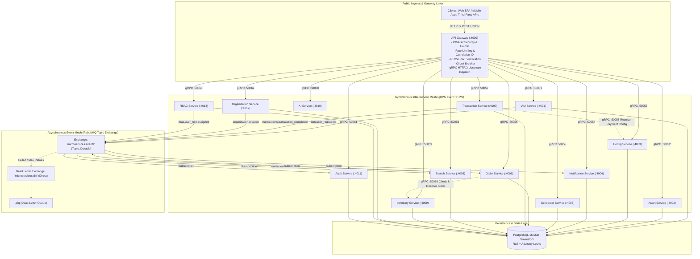
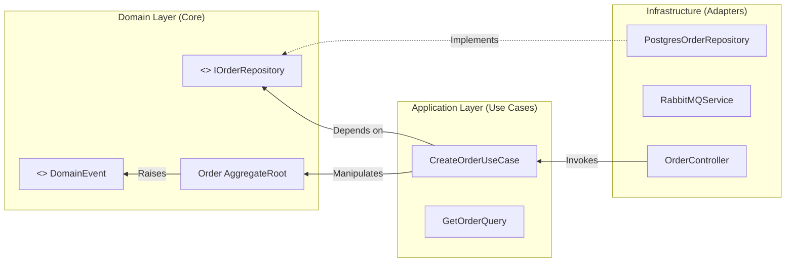
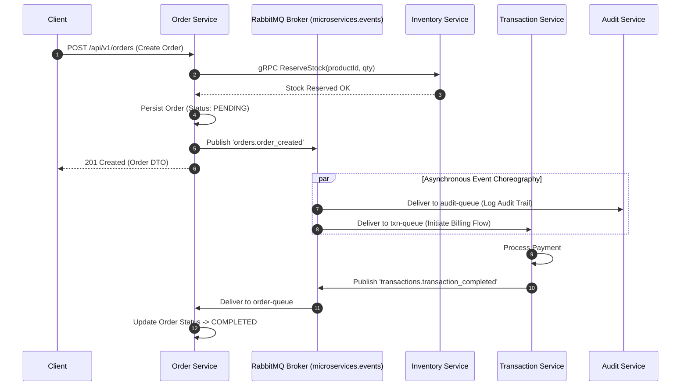
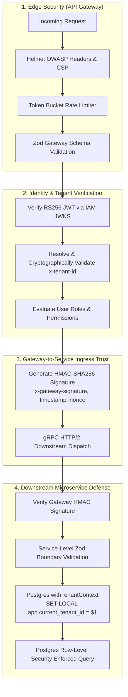
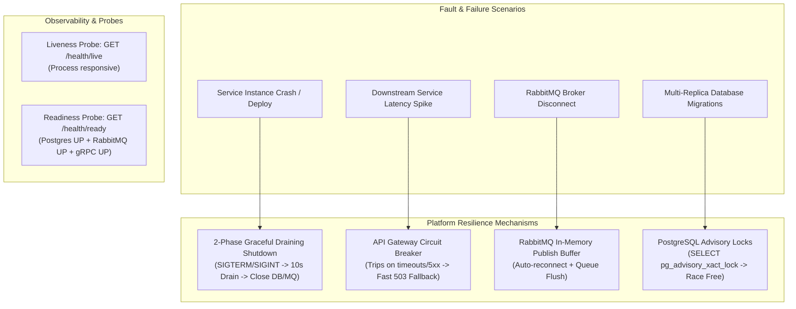

# Enterprise Distributed Microservices Platform — ARCHITECTURE.md
## Architectural Blueprint & System Specification

**Subsystem Root:** `boilerplate/backend-ms`  
**Architecture Topology:** Autonomous Share-Nothing Microservices Mesh  
**Protocols:** gRPC HTTP/2 (Synchronous Inter-Service RPC), RabbitMQ AMQP (Asynchronous Event Choreography), HTTP/REST (Public Gateway Ingress)  
**Primary Datastore:** PostgreSQL 16 (Tenant-Scoped Row-Level Security, ACID Transactions)

---

## Executive Summary & System Overview

The **Enterprise Microservices Platform** (`boilerplate/backend-ms`) is an autonomous, share-nothing, event-driven polyglot-ready backend platform designed to operate at enterprise scale. The system decouples business capabilities into independently deployable bounded contexts, adhering strictly to Domain-Driven Design (DDD), SOLID engineering principles, and a Zero-Trust security model.



---

## 1. Pillar 1: SOLID Principles

Every microservice in this platform is structured to honor the five SOLID object-oriented and architectural principles:

### 1.1 Single Responsibility Principle (SRP)
Each class, module, and layer has one reason to change:
- **Domain Entities (`src/domain/entities/`)**: Enforce business validation invariants and state mutation rules only (e.g. `Order`, `InventoryItem`, `Role`). Zero database or HTTP logic.
- **Value Objects (`src/domain/value-objects/`)**: Encapsulate immutable domain attributes and structural equality (e.g. `Money`, `Email`, `SKU`).
- **Use Cases / Command & Query Handlers (`src/application/`)**: Orchestrate business workflows, fetch aggregates, invoke domain rules, and persist changes.
- **Repository Implementations (`src/infrastructure/persistence/`)**: Translate between domain models and SQL statements.
- **Controllers & Middlewares (`src/presentation/`)**: Handle HTTP serialization, status codes, and input validation schemas.

### 1.2 Open/Closed Principle (OCP)
The system is open for extension but closed for modification:
- **Strategy & Plugin Adapters**: External providers (such as Payment Providers in `transaction-service` or Monitoring Adapters in `audit-service`) implement common interfaces. New providers (e.g., Apple Pay, CloudWatch, Datadog) are added by implementing new adapter classes without altering core use cases.
- **Middleware Pipelines**: Request lifecycle handlers (Authentication, Tenant resolution, Rate limiting, Correlation ID) are composed in Express without modifying route handlers.

### 1.3 Liskov Substitution Principle (LSP)
Abstractions can be swapped with any derived implementation without breaking caller expectations:
- **Repository Substitution**: Domain use cases depend on repository interfaces (e.g., `IOrderRepository`, `IConfigRepository`). In production, `PostgresOrderRepository` executes SQL; in unit tests, `MockOrderRepository` executes against an in-memory `Map`, behaving identically from the caller's perspective.
- **Event Bus Substitution**: The event publishing abstraction (`RabbitMQService` vs `MockEventPublisher`) conforms to the same contract, allowing isolated deterministic testing without real network sockets.

### 1.4 Interface Segregation Principle (ISP)
Clients are not forced to depend on interfaces they do not use:
- Rather than monolithic interfaces, contracts are granular:
  - Command operations depend on write interfaces (`save(entity)`, `delete(id)`).
  - Query operations depend on specialized filter interfaces (`findById(id)`, `findAll(filter)`).
  - Use case interfaces strictly define `execute(request: TRequest): Promise<TResponse>`.

### 1.5 Dependency Inversion Principle (DIP)
High-level policy modules never depend on low-level detail modules. Both depend on abstractions:
- **Ports & Adapters (Hexagonal Architecture)**:
  - Core domain and application layers have **zero** dependencies on Express, PostgreSQL, RabbitMQ, or gRPC.
  - Infrastructure modules (`DatabasePool`, `PostgresRepository`, `RabbitMQService`) adapt the ports defined in `domain/repositories/` and `shared/contracts/`.



---

## 2. Pillar 2: Domain-Driven Design (DDD)

The system is organized into strictly bounded contexts, ensuring model purity and explicit translation boundaries.

### 2.1 Bounded Contexts & Ubiquitous Language

| Microservice | Bounded Context | Primary Ubiquitous Language | Core Aggregate Root |
| :--- | :--- | :--- | :--- |
| `iam-service` | Identity & Access | Subject, Principal, Tenant, Federation Provider, Token, Session | `User`, `Tenant` |
| `rbac-service` | Permissions & Authorization | Role, Permission, Grant, Policy, Assignment | `Role`, `Permission` |
| `organization-service` | Tenant Hierarchy | Organization, Slug, Member, Hierarchy, Status | `Organization`, `OrganizationMember` |
| `order-service` | Order Fulfillment | Order, Line Item, Order Status, Basket Total, Saga | `Order` |
| `inventory-service` | Warehouse & Catalog | Stock, SKU, Reservation, Reorder Threshold, Allocation | `InventoryItem`, `StockReservation` |
| `transaction-service` | Ledger & Payments | Transaction, Payment Gateway, Charge, Refund, Ledger Entry | `Transaction` |
| `asset-service` | Media & Storage | Asset, Blob, Storage Provider, MIME Type, Access Policy | `Asset` |
| `config-service` | Dynamic Governance | Tenant Setting, System Override, Configuration Key | `ConfigSetting` |
| `notification-service` | Communications | Notification, Template, Channel, Dispatch Status | `Notification` |
| `scheduler-service` | Workload Scheduling | Job, Cron Expression, Trigger, Execution Run | `ScheduledJob` |
| `search-service` | Query Indexing | Search Document, Inverted Index, Query Filter, Facet | `SearchDocument` |
| `ai-service` | Intelligent Orchestration | Prompt, LLM Context, MCP Tool, Embedding Vector | `AgentExecution` |
| `audit-service` | Compliance & Observability | Audit Event, Immutable Trail, Remediation Action | `AuditEvent` |
| `api-gateway` | Edge Routing & Security | Reverse Proxy, Rate Limit, Header Propagation, Upstream Target | N/A (Infrastructure Gateway) |

### 2.2 Hexagonal Internal Directory Structure

Every service maintains this identical internal layered layout:

```
services/<service-name>/
├── Dockerfile                   # Standalone multi-stage container build
├── package.json                 # Pruned dependencies (zero runtime monorepo coupling)
├── tsconfig.json                # Strict TypeScript configuration
├── migrations/                  # Idempotent SQL migration scripts
├── tests/                       # In-memory unit and integration test suites
└── src/
    ├── server.ts                # Process bootstrapper, port binding, 2-phase shutdown
    ├── app.ts                   # Express application factory & dependency injection
    ├── domain/                  # PURE BUSINESS LAYER (Zero external dependencies)
    │   ├── entities/            # Entities and Aggregate Roots with invariant guards
    │   ├── value-objects/       # Immutable domain attributes
    │   └── repositories/        # Repository interface ports (contracts)
    ├── application/             # APPLICATION LAYER (Use cases & workflows)
    │   ├── commands/            # State-altering write use cases (CQRS)
    │   ├── queries/             # Read use cases & projections (CQRS)
    │   └── dto/                 # Input/output data transfer objects
    ├── infrastructure/          # ADAPTERS LAYER (External technologies)
    │   ├── database/            # Connection pooling & migration locks
    │   └── persistence/         # PostgreSQL implementations of repository ports
    ├── grpc/                    # High-performance binary RPC server & bridge
    │   ├── <service>.grpc-server.ts
    │   └── express-grpc-bridge.ts
    ├── proto/                   # Protocol Buffer IDL contracts
    │   └── <service>.proto
    ├── presentation/            # PRESENTATION & DELIVERY LAYER
    │   ├── http/                # REST controllers, routes, Zod schemas
    │   └── events/              # RabbitMQ consumer message handlers
    └── shared/                  # ISOLATED SERVICE CHASSIS
        ├── contracts/           # Standard API response structures
        ├── domain/              # Entity, ValueObject, AggregateRoot, Result primitives
        ├── infrastructure/      # Logger, CryptoService, DatabasePool, RabbitMQService
        └── presentation/        # Auth, Tenant, Rate-Limiting, Error middlewares
```

### 2.3 Anti-Corruption Layer (ACL)
Services never directly consume raw external structures. Boundary converters map:
- `Proto Buffer DTO` $\longleftrightarrow$ `Domain Entity`
- `Database Row` $\longleftrightarrow$ `Domain Entity`
- `HTTP Request Body` $\longleftrightarrow$ `Application Command DTO`

---

## 3. Pillar 3: Event-Driven Architecture (EDA)

The platform employs asynchronous event choreography for decoupling, fault tolerance, and eventual consistency across bounded contexts.

### 3.1 Topic Exchange & Routing Topology

- **Primary Exchange**: `microservices.events` (Type: `topic`, `durable: true`).
- **Dead Letter Exchange (DLX)**: `microservices.dlx` (Type: `direct`, `durable: true`).
- **Routing Key Convention**: `<bounded-context>.<entity>.<action>` (e.g., `orders.order_created`, `transactions.transaction_completed`, `iam.user_registered`).



### 3.2 Canonical Integration Event Contract (`DomainIntegrationEvent<T>`)

Every published event adheres to a strict versioned envelope:

```typescript
export interface DomainIntegrationEvent<T = any> {
  id: string;               // Unique UUID v4 for deduplication & idempotency
  eventName: string;        // Fully qualified event name (e.g. "orders.order_created")
  aggregateId: string;      // ID of the emitting Aggregate Root
  occurredAt: string;       // ISO 8601 UTC timestamp
  payload: T;               // Strongly-typed event payload
  version: number;          // Contract schema version (for evolution)
  tenantId?: string;        // Multi-tenant isolation header
  correlationId?: string;   // End-to-end distributed tracing ID
  causationId?: string;     // Parent event ID triggering this event
}
```

### 3.3 Fault Tolerance, Offline Buffering & Dead Letter Queues (DLQ)
- **Offline Memory Buffer**: If RabbitMQ is unavailable during publishing, the service buffers up to 1,000 events in an in-memory queue and flushes them automatically upon reconnection without losing data.
- **Consumer Dead Lettering**: If a consumer handler throws unhandled exceptions after retries, the message is rejected with `nack(false, false)`. RabbitMQ automatically routes it to `microservices.dlx`, landing in `<service-name>.dlq` for forensic inspection and manual replay.

---

## 4. Pillar 4: Test-Driven Development (TDD)

The codebase is built and protected using rigorous Test-Driven Development principles.

```
       / \
      /   \      E2E & Multi-Service Sagas (Order Checkout, Payment, Stock Reservation)
     /=====\
    /       \    Integration Tests (Express HTTP via in-memory Duplex sockets + Zod validation)
   /=========\
  /           \  Domain & Unit Tests (Entities, Value Objects, Use Cases with Mock Repositories)
 /=============\
```

### 4.1 TDD Workflow: Red-Green-Refactor
1. **Red**: Author an automated test case describing the business requirement (in `tests/*.test.ts`) before writing application code. Run `npm test` and verify failure.
2. **Green**: Write the minimal domain and application code required to satisfy the assertion. Run `npm test` and verify passing status.
3. **Refactor**: Clean up design, remove duplication, and optimize while keeping all tests green.

### 4.2 Deterministic In-Memory Testing Architecture
To eliminate flaky tests caused by port collisions, external daemon outages, or environment restrictions:
- Domain and Use Case tests execute with zero network/database I/O using mock repository interfaces (`Map`-backed).
- HTTP presentation tests leverage Node.js `Duplex` streams to invoke Express pipelines in-process without binding external network sockets.

### 4.3 Definition of Done (DoD)
A feature or bugfix is not complete until:
1. All unit and domain tests pass cleanly (`npm test`).
2. TypeScript compiles with zero errors (`npm run build`).
3. Multi-tenant isolation and security permissions are validated.
4. Terminal execution evidence confirms passing status.

---

## 5. Pillar 5: Standardized CRUD Operations & CQRS

All 14 microservices adhere to uniform RESTful resource conventions and Command Query Responsibility Segregation (CQRS).

### 5.1 Standard RESTful Verb Semantics

| HTTP Verb | Path Pattern | Action | Expected Status Code | Description |
| :--- | :--- | :--- | :--- | :--- |
| `POST` | `/api/v1/{resources}` | Create | `201 Created` | Creates a new entity. Returns created representation. |
| `GET` | `/api/v1/{resources}` | List | `200 OK` | Paginated collection with search, filters, and sorting. |
| `GET` | `/api/v1/{resources}/:id` | Detail | `200 OK` | Retrieves a single entity by unique identifier. |
| `PATCH` | `/api/v1/{resources}/:id` | Partial Update | `200 OK` | Updates specific mutable fields of an existing entity. |
| `PUT` | `/api/v1/{resources}/:id` | Full Update | `200 OK` | Full entity replacement or idempotent upsert. |
| `DELETE` | `/api/v1/{resources}/:id` | Delete | `200 OK` / `204 No Content` | Soft delete or hard delete with safety checks. |

### 5.2 Uniform Response Envelope (`StandardResponse<T>`)

Every API endpoint returns a predictable, standardized JSON envelope:

#### Success Envelope (`2xx`):
```json
{
  "success": true,
  "data": {
    "id": "ord_9182371",
    "status": "COMPLETED",
    "totalAmount": 199.99,
    "currency": "USD"
  },
  "meta": {
    "requestId": "req_84a1d2f",
    "timestamp": "2026-11-14T10:15:00.000Z",
    "pagination": {
      "page": 1,
      "limit": 20,
      "total": 1
    }
  }
}
```

#### Error Envelope (`4xx` / `5xx`):
```json
{
  "success": false,
  "error": {
    "code": "ENTITY_NOT_FOUND",
    "message": "Order with ID 'ord_9999' not found",
    "details": null
  },
  "meta": {
    "requestId": "req_84a1d2f",
    "timestamp": "2026-11-14T10:15:00.000Z"
  }
}
```

### 5.3 CQRS (Command Query Responsibility Segregation)
- **Commands (`src/application/commands/`)**: Mutations that alter system state. Enforce transaction boundaries and emit domain events upon success.
- **Queries (`src/application/queries/`)**: Side-effect-free read operations returning projection DTOs optimized for UI rendering without altering entity state.

---

## 6. Pillar 6: Security-First Architecture (Zero-Trust)

Security is implemented in depth at every boundary—network, gateway, inter-service, and datastore.



### 6.1 Cryptographic Authentication & RS256 JWKS
- The **IAM Service** issues asymmetric RS256 JWT access tokens signed by a private key.
- The **API Gateway** and downstreams verify tokens using IAM's public keys fetched via JWKS (`/.well-known/jwks.json`) and cached with in-memory LRU. Symmetric fallback secrets are strictly prohibited in production.

### 6.2 Gateway-to-Service Cryptographic Ingress Verification
To prevent malicious attackers or internal actors from bypassing the API Gateway and spoofing headers (e.g. `x-user-id`, `x-tenant-id`):
- The API Gateway signs every forwarded request using HMAC-SHA256:
  - Header: `x-gateway-signature: sha256=<hash>`
  - Header: `x-gateway-timestamp: <epoch_ms>` (rejects requests older than 300 seconds to prevent replay attacks)
  - Header: `x-gateway-nonce: <uuid_v4>`
- Downstream microservices verify this signature in `auth.middleware.ts`.

### 6.3 Strict Multi-Tenancy & Row-Level Security (RLS)
- Every query executes inside `withTenantContext`:
  ```sql
  BEGIN;
  SELECT set_config('app.current_tenant_id', $1, true);
  -- Queries here are strictly isolated by Postgres RLS policies:
  -- CREATE POLICY tenant_isolation_policy ON <table>
  --   USING (tenant_id = current_setting('app.current_tenant_id'));
  COMMIT;
  ```
- Cross-tenant data leakage is structurally impossible at the database engine level.

---

## 7. Pillar 7: Performance & Scalability

Performance is engineered into every layer to minimize latency and maximize throughput.

### 7.1 Connection Pool Sizing & Workload Tuning
Database connection pool parameters are tailored per microservice classification:

| Service Classification | Examples | `DB_POOL_MAX` | `DB_POOL_MIN` | `statement_timeout` | `idleTimeoutMillis` |
| :--- | :--- | :--- | :--- | :--- | :--- |
| **High-Throughput / Core** | `iam-service`, `order-service`, `transaction-service` | `8` | `2` | `10000ms` | `15000ms` |
| **Moderate / Worker** | `inventory-service`, `notification-service`, `audit-service` | `5` | `1` | `10000ms` | `15000ms` |
| **Read-Heavy / Infrequent** | `config-service`, `asset-service`, `scheduler-service` | `3` | `1` | `10000ms` | `15000ms` |

Slow queries taking longer than `500ms` trigger automated warning logs with query text and execution duration.

### 7.2 Binary gRPC over HTTP/2 Multiplexing
- Downstream communication between the Gateway and microservices runs over **HTTP/2 gRPC channels**.
- Channels are multiplexed with keep-alive pings (`grpc.keepalive_time_ms: 10000`, `grpc.keepalive_timeout_ms: 5000`), eliminating TCP handshake latency for inter-service RPC calls.
- The in-process `express-grpc-bridge.ts` dispatches requests byte-for-byte without intermediate string serialization overhead.

### 7.3 RabbitMQ Consumer Prefetching (QoS)
- Consumers enforce `channel.prefetch(10)`, preventing memory exhaustion by throttling unacknowledged in-flight messages per worker instance.

### 7.4 Multi-Tier Caching
- **JWT Public Keys**: In-memory LRU cache with 1-hour TTL.
- **Dynamic Tenant Configurations**: In-memory cache in `config-service` with 60-second TTL.
- **HTTP Compression**: Gzip/Brotli compression middleware enabled on all Express instances.

---

## 8. Pillar 8: Consistency (Strong vs Eventual)

The platform guarantees data integrity across distributed boundaries through a hybrid consistency model.

```
+-------------------------------------------------------------------------+
|                  Consistency Guarantees Matrix                          |
+------------------------------------+------------------------------------+
|  Within Bounded Context (Local)   |  Across Bounded Contexts (Global)  |
|  - STRONG CONSISTENCY (ACID)       |  - EVENTUAL CONSISTENCY            |
|  - Postgres Transactions           |  - Asynchronous RabbitMQ Events    |
|  - Row-Level Locks & RLS           |  - Saga Distributed Orchestration  |
|  - Immediate Read-After-Write      |  - Compensating Transactions       |
+------------------------------------+------------------------------------+
```

### 8.1 Transaction Boundaries & ACID Isolation
Inside any single microservice, all state changes affecting an Aggregate Root and its entities execute within a single PostgreSQL database transaction. If any validation fails, the transaction is rolled back with zero partial writes.

### 8.2 Distributed Sagas & Compensating Transactions
When a business operation spans multiple services (e.g., Checkout spanning `order-service`, `inventory-service`, and `transaction-service`):
- Services coordinate via orchestrated Sagas.
- If a downstream step fails (e.g., payment declined), compensating actions are triggered (e.g., releasing reserved inventory stock).

### 8.3 Idempotency Guarantees
- All integration events include a unique `id` (UUID v4).
- Consumers maintain deduplication caches or upsert semantics to ensure processing an event more than once produces identical state (at-least-once delivery safety).

---

## 9. Pillar 9: Robustness & Operational Resilience

The system is engineered to withstand component failures, network partitions, and traffic spikes without data loss or cascading failure.



### 9.1 Two-Phase Graceful Shutdown
On receiving `SIGTERM` or `SIGINT`:
1. **Phase 1 (Stop Ingress & Drain)**: The HTTP and gRPC listeners stop accepting new connections. Existing in-flight requests are granted a 10-second drain period to complete.
2. **Phase 2 (Resource Cleanup)**: The application cleanly closes RabbitMQ channels, terminates active database connection pools, and exits with code 0.

### 9.2 API Gateway Circuit Breakers
Calls from the API Gateway to downstream services are guarded by circuit breakers:
- Consecutive timeouts or 5xx errors trip the breaker into `OPEN` state.
- In `OPEN` state, requests fail fast with `503 Service Unavailable`, preventing Gateway event loop starvation and thread exhaustion.
- After a cooling window, the breaker enters `HALF-OPEN` to safely test downstream recovery.

### 9.3 Database Migration Advisory Locks
When multiple service replicas boot simultaneously in Kubernetes or Docker Compose, migration runners acquire an exclusive PostgreSQL transaction-level advisory lock:
```sql
SELECT pg_advisory_xact_lock(hashtext('migration_lock_<service_name>'));
```
This guarantees zero DDL race conditions during automated rolling deployments.

### 9.4 Standardized Health Probes
- `GET /health/live`: Lightweight process liveness probe returning `200 OK`.
- `GET /health/ready`: Deep readiness probe checking connectivity to PostgreSQL (`SELECT 1`), RabbitMQ broker, and gRPC listening status.

---

## 10. Master Verification & Execution Commands

### 10.1 Running All Service Tests
```bash
cd boilerplate/backend-ms
npm run test:all
```

### 10.2 Building All Services
```bash
cd boilerplate/backend-ms
npm run build:all
```

### 10.3 Starting Full Local Stack
```bash
cd boilerplate/backend-ms
npm run docker:up
npm run docker:logs
```

---

*Document Version:* 1.0.0  
*Governance:* Complies with `boilerplate/backend-ms/AGENTS.md` and Enterprise Workspace Standards.

