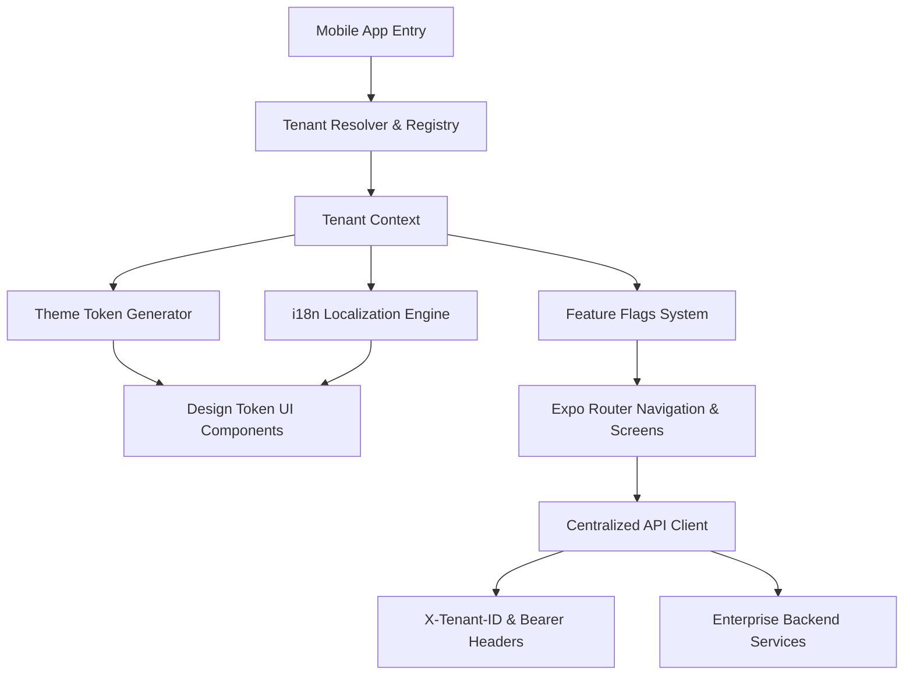

# System Architecture & Technical Principles

## 1. Overview & Core Philosophy

The **Enterprise-Ready Multi-Tenant White-Label React Native Boilerplate** is engineered as a foundational mobile client capable of serving multiple business clients, diverse industry verticals (retail, healthcare, finance, logistics), and varied branding identities from a single unified codebase.

Instead of maintaining separate repositories or brittle build-time forks for each client, this architecture achieves multi-tenancy dynamically through **configuration, centralized design tokens, and modular feature flags**.

---

## 2. Layered Architecture

The application is structured into clearly separated layers:

1. **Core Layer (`src/core/`)**:
   - `tenant/`: Zod configuration schemas, runtime tenant registry, resolution pipeline, and React context.
   - `theme/`: Mathematical color calculation, contrast luminance algorithms, and design tokens (spacing, typography, elevation).
   - `features/`: Typed feature-flag evaluation engine.
   - `i18n/`: Internationalization initialization, resource bundles, and locale-aware number/currency/date formatters.
   - `api/`: Typed HTTP client with timeout, cancellation, tenant-header injection, and normalized `ApiError` mapping.
   - `auth/`: Session management, token persistence, and Zustand session state.
   - `storage/`: Secure storage abstraction (`ExpoSecureStore` with safe memory fallback for web and tests).

2. **UI Component Layer (`src/components/`)**:
   - `ui/`: Design-token-powered native components (`AppButton`, `AppText`, `AppInput`, `AppCard`, `AppHeader`, `AppModal`, etc.).
   - `layout/`: Safe-area and scroll containers (`AppScreen`).
   - `feedback/`: State feedback primitives (`AppLoader`, `AppError`, `AppEmptyState`).

3. **Feature Modules Layer (`src/features/`)**:
   - Encapsulated business features (`auth`, `profile`, `tenant`, `settings`).
   - Each feature encapsulates its own hooks, services, types, and presentation components.

4. **Routing Layer (`src/app/`)**:
   - Powered by Expo Router with file-based routing.
   - Distinct route groups: `(public)` for guest access, `(protected)` for authenticated sessions with navigation guards.

---

## 3. State Management Strategy

To prevent over-engineering and high render overhead, state is split into specialized tiers:

| Scope | Technology | Purpose |
| :--- | :--- | :--- |
| **Server State** | TanStack Query (`@tanstack/react-query`) | Async API caching, automatic deduplication, cache invalidation |
| **Session / Tenant State** | Zustand & React Context | Global tenant branding, active user identity, authentication status |
| **Form State** | React Hook Form & Zod | Ephemeral form inputs, validation rules, error handling |
| **Persistent Secrets** | Expo SecureStore | Access tokens, refresh tokens, sensitive credentials |
| **Non-Sensitive Prefs** | AsyncStorage | Selected theme mode, chosen locale, last active tenant slug |

---

## 4. Performance & Rendering Guardrails

- **Token-Driven Styling**: StyleSheet styles are calculated once per theme change rather than on every render cycle.
- **Pure Functional Components**: Lightweight component footprints without massive component-library overhead.
- **Cross-Platform Parity**: Zero crash footprint on iOS, Android, and Web environments.
