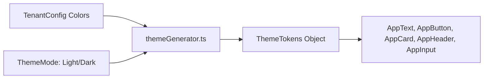

# White-Label Theming & Design Token Engine

## 1. Design Token Architecture

The theming engine transforms a tenant's brand configuration into a comprehensive set of typed design tokens. Rather than hardcoding colors into screens, all components consume tokens via the `useTheme()` hook.



---

## 2. Token Categories

### Colors (`theme.colors`)
- `primary`, `primaryLight`, `primaryDark`, `primaryContrast`
- `secondary`, `secondaryLight`, `secondaryDark`, `secondaryContrast`
- `accent`, `accentContrast`
- `background`, `surface`, `surfaceSubtle`, `surfaceCard`, `border`, `borderLight`
- `text`, `textSecondary`, `textMuted`, `textInverse`
- `status`: `success`, `warning`, `error`, `info`

### Typography (`theme.typography`)
- `fontSizes`: `xs` (11), `sm` (13), `md` (15), `lg` (18), `xl` (22), `xxl` (28), `display` (34)
- `lineHeights`: Proportional line heights for optimal mobile readability
- `weights`: `regular` ('400'), `medium` ('500'), `semibold` ('600'), `bold` ('700')

### Spacing & Radii (`theme.spacing`, `theme.radii`)
- `spacing`: `none` (0), `xs` (4), `sm` (8), `md` (16), `lg` (24), `xl` (32), `xxl` (48)
- `radii`: `none` (0), `sm` (6), `md` (10), `lg` (16), `full` (9999)

### Elevation & Shadows (`theme.elevation`)
- Platform-optimized shadow definitions: `none`, `sm`, `md`, `lg`.
- On iOS: subtle `shadowOffset`, `shadowOpacity`, and `shadowRadius`.
- On Android: native `elevation`.

---

## 3. Dynamic Contrast & Luminance Algorithm

To ensure WCAG accessibility compliance across dynamically configured tenant colors, the theming engine calculates relative luminance:

```ts
export function getContrastColor(hexColor: string): string {
  const cleanHex = hexColor.replace('#', '');
  const r = parseInt(cleanHex.substring(0, 2), 16) || 0;
  const g = parseInt(cleanHex.substring(2, 4), 16) || 0;
  const b = parseInt(cleanHex.substring(4, 6), 16) || 0;
  const yiq = (r * 299 + g * 587 + b * 114) / 1000;
  return yiq >= 140 ? '#0F172A' : '#FFFFFF';
}
```

If a tenant configures a bright yellow or neon cyan primary color, button text automatically flips to dark slate `#0F172A`. For deep blue or emerald green, text flips to `#FFFFFF`.

---

## 4. Light and Dark Theme Modes

- **Light Mode**: Leverages the tenant's specified `backgroundColor` and `surfaceColor`, with soft borders.
- **Dark Mode**: Automatically computes deep slate background (`#0B0F17`), raised dark surfaces (`#151C28`), and muted text shades while retaining the tenant's primary brand identity.
- **Tenant Control**: Dark mode can be enabled or disabled per tenant using the `darkMode` feature flag in `tenant.enabledFeatures`.
