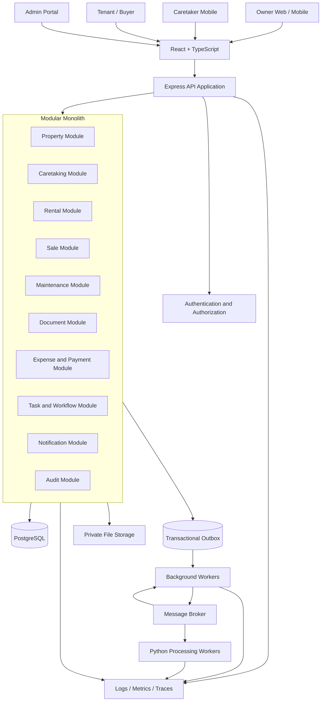

# Real Estate CareTaking — Technical Architecture

**Document:** `architecture.md`  
**Version:** 1.0  
**Status:** Proposed Architecture Baseline  
**Product:** Real Estate CareTaking  
**Architecture Style:** DDD + Modular Monolith + Event-Driven Architecture  
**Primary Backend:** Node.js, TypeScript, Express  
**Specialized Workers:** Python  
**Database:** PostgreSQL  
**Frontend:** React, TypeScript  
**Containerization:** Docker  
**Future Orchestration:** Kubernetes  
**Infrastructure Management:** Infrastructure as Code (IaC)

---

# 1. Purpose and Scope

## 1.1 Purpose

This document defines the mandatory technical architecture, coding standards, module boundaries, security controls, performance requirements, testing practices, deployment standards, and scalability strategy for the Real Estate CareTaking platform.

It serves as the single source of truth for:

- Human developers.
- AI coding agents.
- Architects and technical leads.
- QA engineers.
- DevOps and platform engineers.
- Code reviewers.
- Future teams extracting modules into microservices.

Every implementation must conform to this document unless an approved Architecture Decision Record (ADR) documents an exception.

## 1.2 Product Context

The platform coordinates property owners, caretakers, tenants, buyers, maintenance vendors, brokers, and qualified documentation professionals.

The system must support:

1. Property onboarding and verification.
2. Caretaker onboarding and assignment.
3. Owner-controlled permissions and approvals.
4. Property rental management.
5. Property sale coordination.
6. Maintenance and vendor workflows.
7. Custom task fulfilment.
8. Property documentation.
9. Expense and payment coordination.
10. Notifications, reporting, and audit trails.

Business operations must remain traceable, permission-controlled, and recoverable.

## 1.3 Architecture Objectives

- Minimize initial infrastructure and operational complexity.
- Enforce strict module boundaries.
- Maximize reuse without creating tightly coupled shared code.
- Apply SOLID principles and appropriate design patterns.
- Support automated testing at every architectural layer.
- Keep routine API response latency below 200 ms at the defined percentile.
- Move suitable long-running work into background processing.
- Protect owner information, property documents, financial records, and permissions.
- Allow independently deployable services to emerge from existing module boundaries.
- Support horizontal scaling and low-downtime releases.
- Avoid unnecessary frameworks, abstractions, infrastructure, and dependencies.

---

# 2. Mandatory Architecture Principles

## 2.1 Architectural Rules

| ID | Principle | Mandatory rule |
|---|---|---|
| ARCH-001 | Modular monolith first | Deploy the core application as one application unit initially. |
| ARCH-002 | Domain boundaries | Each module owns its domain rules and application use cases. |
| ARCH-003 | SOLID | Apply SOLID principles where they improve cohesion, testability, and change isolation. |
| ARCH-004 | DDD | Use bounded contexts, domain entities, value objects, and domain services where appropriate. |
| ARCH-005 | Event-driven design | Communicate cross-module business changes through explicit events where asynchronous communication is appropriate. |
| ARCH-006 | Dependency inversion | Domain logic must not depend on Express, PostgreSQL drivers, cloud SDKs, or UI frameworks. |
| ARCH-007 | Factory pattern | Use factories for objects requiring meaningful creation rules, validation, or runtime implementation selection. |
| ARCH-008 | API-first | Expose versioned, documented API contracts independently of UI implementation. |
| ARCH-009 | Security by default | Deny access unless an explicit authorization policy permits it. |
| ARCH-010 | Testability | Every business use case must be testable without starting the full production infrastructure. |
| ARCH-011 | Performance | Measure API latency and prevent unsuitable long-running work from blocking request processing. |
| ARCH-012 | Portability | Business modules must not depend on a specific deployment platform. |
| ARCH-013 | Observability | Use structured logs, metrics, traces, correlation identifiers, and health checks. |
| ARCH-014 | Reuse | Reuse stable, cohesive capabilities rather than copying implementations or creating generic abstractions prematurely. |
| ARCH-015 | Evolution | Extract a module into a service only when justified by measurable operational or business needs. |

## 2.2 Engineering Principles

Follow:

- SOLID.
- DRY: Don't Repeat Yourself.
- KISS: Keep It Simple.
- YAGNI: You Aren't Gonna Need It.
- Composition over inheritance.
- Explicit dependencies.
- Fail-safe defaults.
- Least privilege.
- Separation of concerns.
- Single source of truth for each business invariant.
- Backward-compatible API and event evolution.

Do not introduce a design pattern merely to demonstrate that a pattern is being used.

---

# 3. Technology Standards

## 3.1 Approved Stack

| Layer | Technology | Responsibility |
|---|---|---|
| Web frontend | React + TypeScript | User interfaces |
| API backend | Node.js + TypeScript + Express | Transactional HTTP APIs |
| Specialized workers | Python | Document processing, AI and suitable computational tasks |
| Primary database | PostgreSQL | Transactional and relational data |
| Validation | TypeScript-compatible schema validation | Request and configuration validation |
| API documentation | OpenAPI | API contracts |
| Testing | Unit, integration, contract, E2E and load tests | Correctness and reliability |
| Containers | Docker | Reproducible runtime packaging |
| Orchestration | Kubernetes, when justified | Scheduling, scaling and recovery |
| IaC | Terraform, OpenTofu or an approved equivalent | Reproducible infrastructure |
| CI/CD | Repository-integrated pipelines | Build, test, scan and deploy |
| Messaging | Broker abstraction with a durable implementation when required | Asynchronous event delivery |
| Observability | OpenTelemetry-compatible instrumentation | Logs, metrics and traces |

## 3.2 Dependency Policy

- Pin dependencies using a lockfile.
- Prefer maintained packages with suitable licenses.
- Review package provenance, known vulnerabilities, maintenance status, and transitive dependencies.
- Avoid unnecessary runtime dependencies.
- Keep infrastructure-specific integrations behind adapters.
- Do not expose database models directly as public API contracts.
- Avoid maintaining two implementations of the same business rule in TypeScript and Python.
- Use Python as a separate worker runtime when independent scaling or isolation is needed.

A Python worker must communicate through a defined API, command interface, or versioned message contract. It must not directly manipulate another module's private database tables.

## 3.3 TypeScript Standards

- Enable strict type checking.
- Avoid `any`; use `unknown` and explicit narrowing when appropriate.
- Validate untrusted runtime data independently of TypeScript types.
- Use explicit return types for public application and domain interfaces.
- Use exhaustive handling for domain variants and state transitions.
- Do not use type assertions to bypass meaningful validation.
- Keep application configuration typed and validated at startup.

---

# 4. System Architecture

## 4.1 Logical Architecture



This diagram describes logical boundaries. It does not require every module to be a separate process.

## 4.2 Request Processing

Every API request must follow a predictable processing path:

1. Receive the request.
2. Apply request size limits and transport-level protections.
3. Authenticate the caller.
4. Validate the request against the API schema.
5. Authorize the requested action and resource.
6. Invoke the relevant application use case.
7. Apply domain invariants.
8. Execute required database operations within an appropriate transaction.
9. Persist relevant audit and outbox records atomically.
10. Return the documented response.
11. Perform suitable asynchronous work through background workers.

Not every operation needs every step in exactly the same form. Security, validation, and domain invariants must never be bypassed for convenience.

---

# 5. Repository and Directory Structure

Use a monorepo with explicit application and module boundaries.

```text
real-estate-caretaking/
├── apps/
│   ├── api/
│   │   └── src/
│   │       ├── bootstrap/
│   │       ├── config/
│   │       ├── http/
│   │       ├── middleware/
│   │       ├── observability/
│   │       └── server.ts
│   │
│   ├── web/
│   │   └── src/
│   │       ├── app/
│   │       ├── features/
│   │       ├── components/
│   │       ├── hooks/
│   │       └── infrastructure/
│   │
│   └── workers/
│       ├── typescript/
│       └── python/
│
├── modules/
│   ├── identity/
│   ├── property/
│   ├── caretaker/
│   ├── assignment/
│   ├── rental/
│   ├── sale/
│   ├── maintenance/
│   ├── task-management/
│   ├── documents/
│   ├── finance/
│   ├── vendors/
│   ├── notifications/
│   └── audit/
│
├── packages/
│   ├── api-contracts/
│   ├── event-contracts/
│   ├── observability/
│   ├── testing/
│   ├── security/
│   └── shared-kernel/
│
├── database/
│   ├── migrations/
│   └── seeds/
│
├── infrastructure/
│   ├── docker/
│   ├── compose/
│   ├── iac/
│   ├── kubernetes/
│   └── monitoring/
│
├── tests/
│   ├── integration/
│   ├── contract/
│   ├── e2e/
│   ├── security/
│   └── performance/
│
├── docs/
│   ├── adr/
│   ├── api/
│   ├── runbooks/
│   └── diagrams/
│
├── architecture.md
├── CONTRIBUTING.md
├── SECURITY.md
├── package.json
└── README.md
```

The tree is a logical baseline. Keep the number of top-level directories and packages proportional to actual complexity.

## 5.1 Mandatory Module Structure

Every business module must follow the same internal structure.

```text
modules/property/
├── domain/
│   ├── entities/
│   ├── value-objects/
│   ├── services/
│   ├── events/
│   ├── policies/
│   ├── repositories/
│   └── errors/
│
├── application/
│   ├── use-cases/
│   ├── commands/
│   ├── queries/
│   ├── dto/
│   ├── ports/
│   └── mappers/
│
├── infrastructure/
│   ├── persistence/
│   ├── repositories/
│   ├── factories/
│   └── adapters/
│
├── presentation/
│   └── http/
│       ├── routes.ts
│       ├── controllers/
│       ├── validators/
│       └── presenters/
│
├── tests/
│   ├── unit/
│   ├── integration/
│   └── contract/
│
├── module.ts
└── README.md
```

A small module may combine closely related files, but must preserve the architectural responsibilities.

### Directory responsibilities

**Domain:** Business invariants, entities, value objects, domain events, policies, and domain-level abstractions.

**Application:** Use cases, transaction boundaries, orchestration, authorization checks, and application ports.

**Infrastructure:** Database adapters, external integrations, messaging implementations, and framework-specific implementations of ports.

**Presentation:** HTTP routes, request validation, controllers, and response mapping.

**Tests:** Tests appropriate to the module's public behavior and implementation.

**module.ts:** Explicit composition root for module dependencies and public capabilities.

---

# 6. Dependency Rules and Module Boundaries

## 6.1 Dependency Direction

The permitted dependency direction is:

```text
Presentation
     |
     v
Application
     |
     v
Domain

Infrastructure ---> Application Ports / Domain Interfaces
```

Infrastructure implements abstractions defined by the inner layers. The domain must not import infrastructure.

## 6.2 Cross-Module Access

Modules must not import another module's internal implementation.

Allowed:

- Importing a declared public interface.
- Calling an application service through a public module contract.
- Publishing or consuming a versioned domain integration event.
- Using an explicitly approved shared-kernel type.

Not allowed:

- Importing another module's repository implementation.
- Writing directly to another module's tables.
- Accessing another module's private entity internals.
- Creating circular module dependencies.
- Calling another module's database models from controllers.
- Reimplementing another module's business rules.

Each module must publish a small, documented public API.

Example:

```typescript
export interface PropertyModule {
  getPropertyDetails(
    propertyId: string,
    actorId: string,
  ): Promise<PropertyDetails>;
}
```

The interface above is illustrative. Actual authorization must also validate tenant, property scope, and actor permissions.

## 6.3 Dependency Enforcement

Automated architecture tests and static analysis must verify:

- No circular module dependencies.
- No domain-to-infrastructure imports.
- No unauthorized cross-module imports.
- No direct database access from controllers.
- No public API bypass of application use cases.

Architecture violations must fail CI rather than being left to reviewer judgment alone.

---

# 7. Domain-Driven Design

## 7.1 Bounded Contexts

Organize modules according to business ownership, not merely database tables.

| Bounded context | Responsibility |
|---|---|
| Identity and Access | Accounts, authentication integration, roles and permissions |
| Property | Property records, classification, status and ownership evidence references |
| Caretaking | Caretaker profiles, qualifications and availability |
| Assignment | Property-caretaker relationships, scope, and authorization grants |
| Rental | Rental listings, leads, lease coordination and tenancy milestones |
| Sale | Sale listings, offers, transaction coordination and milestones |
| Maintenance | Repair requests, quotations, vendor jobs and completion |
| Task Management | General tasks, workflows, deadlines and escalations |
| Documents | Secure document metadata, versions and access policies |
| Finance | Fees, expenses, invoices, payment references and reconciliation |
| Notifications | Delivery requests, channel adapters and delivery status |
| Audit | Security-relevant and business activity records |

A context may contain multiple internal entities. Do not create a separate service for every entity.

## 7.2 Domain Invariants

Examples of mandatory business rules:

- A caretaker cannot act outside the scope of an active assignment.
- An expense requiring owner approval cannot proceed through the standard workflow without that approval.
- A revoked permission cannot authorize a new restricted action.
- A property listing cannot be published without the required listing permissions and validation.
- An offer must not be represented as owner-accepted until the required owner decision is recorded.
- A completed maintenance task must satisfy its configured evidence requirements.
- Sensitive documents must not be shared with unauthorized recipients.
- A payment must not be treated as settled merely because a payment request was created.

Enforce these rules inside application and domain workflows. UI validation is supplementary, not authoritative.

## 7.3 Entity and Value Object Standards

Entities should have stable identities and enforce valid state transitions.

Value objects should represent concepts such as:

- Money.
- Property address.
- Contact details.
- Service scope.
- Approval thresholds.
- Date ranges.
- Property identifiers.
- Document classifications.

Use integer minor units for currencies where appropriate, or PostgreSQL `NUMERIC` with explicit precision and scale. Do not use binary floating-point values for financial calculations.

## 7.4 Aggregate Boundaries

Use aggregates to protect invariants that must be maintained atomically.

Examples:

- Caretaker assignment and its authorization scope.
- A maintenance request and its approval state.
- A rental offer or sale offer and its decision history.
- A payment record and its state transitions.

Do not make an entire property portfolio a single aggregate. Keep transactions small and avoid locking unrelated properties.

---

# 8. SOLID Principles

## 8.1 Single Responsibility Principle

A class or module should have one coherent reason to change.

For example, separate:

- Property validation.
- Property persistence.
- Listing publication.
- Notification delivery.
- Expense approval.

Do not create a single service responsible for all property operations.

## 8.2 Open/Closed Principle

Introduce extension points for capabilities expected to vary.

Examples:

- Notification channels.
- Payment providers.
- Document storage adapters.
- Caretaker assignment strategies.
- Vendor selection strategies.

Do not create extension frameworks for fixed business rules with no foreseeable variation.

## 8.3 Liskov Substitution Principle

Implementations of the same interface must honor the same behavioral contract.

A replacement notification provider must not silently change delivery semantics, error handling, or idempotency guarantees.

## 8.4 Interface Segregation Principle

Keep interfaces focused.

Prefer `PropertyReader`, `PropertyWriter`, and `PropertyApprovalPolicy` where distinct use cases require different capabilities, rather than giving every consumer a broad repository with unrestricted methods.

## 8.5 Dependency Inversion Principle

High-level use cases must depend on abstractions rather than concrete database, network, or framework implementations.

Example:

```typescript
export interface PropertyRepository {
  findById(id: string): Promise<Property | null>;
  save(property: Property): Promise<void>;
}
```

The PostgreSQL adapter implements this contract. Domain and application code must not import the PostgreSQL client directly.

---

# 9. Factory Design Pattern

## 9.1 Purpose

Use the Factory pattern when object creation requires business validation, a selected implementation, configuration, or a meaningful construction process.

Suitable use cases:

- Notification provider selection.
- Payment provider selection.
- Document storage adapter selection.
- Caretaker assignment strategy selection.
- Domain object construction with invariants.
- Supported document processor selection.

## 9.2 Example

```typescript
export interface NotificationProvider {
  send(message: NotificationMessage): Promise<DeliveryResult>;
}

export class NotificationProviderFactory {
  constructor(
    private readonly providers: Record<
      string,
      NotificationProvider
    >,
  ) {}

  create(channel: string): NotificationProvider {
    const provider = this.providers[channel];

    if (!provider) {
      throw new UnsupportedNotificationChannelError(channel);
    }

    return provider;
  }
}
```

The factory must receive approved implementations through dependency injection.

Security requirements:

- Never load arbitrary code based on a database value.
- Never accept user-controlled class names or module paths.
- Validate provider configuration at startup.
- Fail safely when no valid provider is configured.
- Avoid creating a new provider instance per request when reuse is safe.

A factory must not become a service locator for the entire application. Use constructor injection for ordinary dependencies.

---

# 10. Application and API Design

## 10.1 REST API Standards

- Use `/api/v1/` as the initial versioned API prefix.
- Use resource-oriented routes and standard HTTP methods.
- Validate all incoming parameters, request bodies, and query strings.
- Use explicit request and response DTOs.
- Publish OpenAPI specifications.
- Use consistent pagination and filtering.
- Apply idempotency to suitable retry-sensitive operations.
- Return appropriate HTTP status codes.
- Avoid exposing internal stack traces or database errors.

Example routes:

```text
POST   /api/v1/properties
GET    /api/v1/properties/:propertyId
PATCH  /api/v1/properties/:propertyId

POST   /api/v1/properties/:propertyId/assignments
POST   /api/v1/assignments/:assignmentId/approvals

POST   /api/v1/properties/:propertyId/maintenance-requests
POST   /api/v1/maintenance-requests/:requestId/quotations
POST   /api/v1/maintenance-requests/:requestId/approvals

POST   /api/v1/properties/:propertyId/rental-listings
POST   /api/v1/properties/:propertyId/sale-listings
GET    /api/v1/properties/:propertyId/activity
```

These are illustrative contracts. Final routes must reflect the relevant domain ownership and authorization model.

## 10.2 Response Format

Use a consistent response envelope when it adds value to the API contract.

Successful synchronous operation:

```json
{
  "data": {
    "id": "resource-id",
    "status": "active"
  },
  "meta": {
    "requestId": "request-id"
  }
}
```

Validation or business error:

```json
{
  "error": {
    "code": "APPROVAL_REQUIRED",
    "message": "Owner approval is required before work can proceed.",
    "requestId": "request-id"
  }
}
```

Asynchronous operation accepted:

```json
{
  "data": {
    "jobId": "job-id",
    "status": "accepted"
  },
  "meta": {
    "requestId": "request-id"
  }
}
```

Use a consistent error schema, and document any operation-specific response variations.

## 10.3 HTTP Status Codes

- `200 OK`: Successful read or operation.
- `201 Created`: Resource created.
- `202 Accepted`: Work accepted for asynchronous processing.
- `204 No Content`: Successful operation with no response body.
- `400 Bad Request`: Malformed request.
- `401 Unauthorized`: Missing or invalid authentication.
- `403 Forbidden`: Authenticated caller lacks permission.
- `404 Not Found`: Resource unavailable or intentionally concealed.
- `409 Conflict`: State conflict or duplicate operation.
- `422 Unprocessable Content`: Valid request syntax but invalid domain input, when this convention is used.
- `429 Too Many Requests`: Rate limit exceeded.
- `500 Internal Server Error`: Unexpected internal failure.
- `503 Service Unavailable`: Temporarily unavailable dependency or service.

Do not return HTTP 200 for failed business operations.

---

# 11. Performance Architecture — 200 ms Target

## 11.1 Performance Objective

The initial target for routine APIs is:

**Server-side API latency: p95 ≤ 200 ms under the agreed representative load.**

Define the measurement boundaries explicitly:

- Measure from API request acceptance to response completion.
- Exclude client rendering and internet transit.
- Report database time and dependency time separately.
- Track p50, p95, and p99.
- Measure cold starts separately where relevant.
- Validate against realistic property counts, data volumes, and concurrent requests.

The target is a service-level objective, not a guarantee for every request or third-party dependency.

## 11.2 API Classification

| Class | Examples | Execution strategy |
|---|---|---|
| Fast read | Property summary, task list, assignment status | Synchronous |
| Fast write | Create task, submit approval, update a small record | Synchronous transaction |
| Potentially slow | Complex reports, bulk imports, large document processing | Asynchronous when immediate completion is unnecessary |
| External dependency | Third-party identity verification, payment gateway calls | Bounded timeout; async workflow when suitable |
| Long-running | PDF processing, large media processing, bulk notifications | Background worker |
| Business-critical state change | Approve expense, record offer decision, revoke permission | Persist authoritative decision synchronously |

Do not move an operation to the background merely because it crosses 200 ms if the client requires its authoritative result before proceeding. Optimize it, establish an explicit latency budget, or redesign the interaction.

## 11.3 Asynchronous Workflow

For work that can safely execute asynchronously:

1. Validate the request.
2. Authenticate and authorize the caller.
3. Persist the requested operation and job metadata.
4. Persist an outbox event in the same database transaction where applicable.
5. Return `202 Accepted` with a job or operation identifier.
6. Publish the event through a reliable worker.
7. Process the job with bounded retries and idempotency.
8. Update the job status.
9. Notify the client or make the status available through polling or another supported mechanism.

The application must not return a success response for work that has not been durably accepted.

## 11.4 Database Performance

- Add indexes based on actual query plans and workload.
- Use pagination for potentially large collections.
- Avoid N+1 queries.
- Select only required columns.
- Keep transactions short.
- Avoid remote network calls inside database transactions.
- Configure connection pooling.
- Use statement timeouts and query monitoring.
- Review slow queries using PostgreSQL execution plans.
- Use keyset pagination for large, frequently changing lists where appropriate.
- Use optimistic concurrency or row locking where required by business invariants.
- Add caching only where invalidation and authorization are well defined.

## 11.5 Caching

Suitable candidates:

- Static reference data.
- Non-sensitive configuration.
- Read-heavy summaries.
- Carefully invalidated public listing data.

Do not rely on cache contents as the authoritative source for permissions, payment status, owner approvals, or security-critical state transitions.

Tenant-scoped or user-specific cache keys must include all relevant authorization and isolation dimensions.

## 11.6 Performance Budgets

Establish an initial request budget:

| Component | Initial budget |
|---|---:|
| Request parsing and validation | 10–20 ms |
| Authentication and authorization | 10–25 ms |
| Application and domain logic | 20–40 ms |
| Database operations | 30–70 ms |
| Serialization and remaining overhead | 10–25 ms |
| Reserved headroom | Remaining budget to p95 200 ms |

These are engineering allocations, not additive guarantees or measurements. Validate the actual end-to-end distribution using load tests and production telemetry.

---

# 12. Event-Driven Architecture

## 12.1 Event Design

Events communicate facts that have already occurred.

Examples:

- `PropertyCreated`
- `CaretakerAssignmentAccepted`
- `PermissionRevoked`
- `MaintenanceApprovalGranted`
- `MaintenanceCompleted`
- `RentalEnquiryReceived`
- `SaleOfferSubmitted`
- `SaleOfferDecisionRecorded`
- `DocumentReviewCompleted`
- `InvoiceRecorded`

Use commands for requested actions and events for completed facts. Do not treat the two as interchangeable.

## 12.2 Event Contract

Every integration event should include:

- Event identifier.
- Event type.
- Schema version.
- Occurrence timestamp.
- Producer or source module.
- Relevant aggregate identifier.
- Correlation identifier.
- Causation identifier where applicable.
- Minimum required payload.

Events must contain only information necessary for their consumers. Avoid embedding full property documents, authentication secrets, or unnecessary personal information.

## 12.3 Transactional Outbox

When a database state change must reliably produce an event:

1. Persist the business state.
2. Persist the corresponding outbox record in the same transaction.
3. Commit both together.
4. Publish pending events asynchronously.
5. Mark successful publications.
6. Retry failures with bounded backoff.
7. Monitor stuck records and dead-letter events.

This prevents a successful database commit from silently losing its corresponding event.

## 12.4 Delivery Semantics

Assume at-least-once event delivery.

Therefore:

- Consumers must be idempotent.
- Duplicate event processing must not duplicate payments, invoices, or business actions.
- Consumers must record processed event identifiers where appropriate.
- Ordering must be explicitly defined for events that require it.
- Failed messages must have a documented retry and recovery strategy.
- Dead-letter messages must be observable and recoverable.

Do not promise end-to-end exactly-once execution across databases, brokers, and external providers.

## 12.5 In-Process Events vs. Message Broker

Initially, modules may use an in-process dispatcher for local notifications that do not require durable delivery.

Use a transactional outbox and durable broker when delivery must survive process failure or support independent consumers.

Do not introduce a broker solely to communicate between methods inside the same module.

---

# 13. Security Architecture

## 13.1 Security Standard

The application must align its secure development process with the OWASP Top 10 for the applicable release, OWASP API Security Top 10, and appropriate verification guidance from OWASP ASVS.

Security must be validated through automated tests, code review, dependency scanning, configuration review, and independent VAPT.

No architecture document or automated scanner alone can certify the application as secure.

## 13.2 Authentication

- Use a maintained OIDC-compatible identity provider where appropriate.
- Validate issuer, audience, signature, expiry, and permitted token algorithms.
- Use short-lived access tokens and an appropriate refresh strategy.
- Protect refresh tokens and browser sessions.
- Implement account recovery securely.
- Support session and token revocation where required.
- Never log credentials, access tokens, or refresh tokens.

## 13.3 Authorization

- Apply RBAC for broad role permissions.
- Apply resource-level authorization for individual properties, assignments, tasks, and documents.
- Enforce owner, tenant, caretaker, vendor, and organization boundaries.
- Apply explicit assignment scope and permission checks.
- Validate authorization on every sensitive API operation.
- Default to deny.
- Audit permission grants, changes, and revocations.

RBAC alone is insufficient. The system must also prevent broken object-level authorization and insecure direct object references.

## 13.4 OWASP Risk Controls

| Risk area | Required controls |
|---|---|
| Broken access control | Server-side authorization, resource ownership checks, deny-by-default policies |
| Cryptographic failures | TLS, managed encryption keys, secure secrets handling, appropriate encryption at rest |
| Injection | Parameterized SQL, safe query builders, input validation, safe process invocation |
| Insecure design | Threat modeling, explicit approval policies, abuse-case analysis |
| Security misconfiguration | Hardened deployments, secure headers, minimal privileges, configuration validation |
| Vulnerable components | Dependency scanning, lockfiles, patch policy, SBOM where appropriate |
| Authentication failures | Secure sessions, token validation, rate limiting, recovery protections |
| Software and data integrity failures | Protected CI/CD, artifact integrity, reviewed migrations, signed artifacts where supported |
| Logging and monitoring failures | Structured security logs, alerting, audit records, incident runbooks |
| SSRF and unsafe external access | Egress controls, URL allowlists where applicable, private-address blocking and redirect validation |

For APIs, explicitly assess object-level authorization, broken authentication, property-level authorization, resource consumption, function-level authorization, sensitive business-flow abuse, SSRF, misconfiguration, and unsafe consumption of external APIs.

## 13.5 OWASP VAPT Requirements

Before production launch:

- Perform authenticated and unauthenticated application security testing.
- Test access control across owners, caretakers, tenants, buyers, vendors, and administrators.
- Test tenant and property data isolation.
- Test approval bypass attempts.
- Test document access and sharing links.
- Test session handling and account recovery.
- Test injection, XSS, CSRF where applicable, SSRF, and rate limiting.
- Test file upload validation and malware-handling controls.
- Test business logic abuse, replay, duplicate requests, and privilege escalation.
- Review infrastructure, container images, dependency vulnerabilities, and secrets exposure.
- Remediate critical and high-severity findings before launch, unless a formally approved exception establishes effective compensating controls and an appropriate remediation deadline.
- Retest fixes and preserve the final report.

Perform independent VAPT before major production releases and periodically thereafter, with frequency determined by risk, regulatory obligations, and significant architecture changes.

## 13.6 Document Security

- Store private documents outside publicly accessible web roots.
- Use short-lived signed links or authenticated download endpoints.
- Validate file type, size, and content.
- Generate storage keys independently of uploaded filenames.
- Scan uploaded files where supported.
- Enforce access checks before issuing downloads.
- Record document sharing and access events.
- Define retention and deletion policies.

---

# 14. Database Architecture

## 14.1 PostgreSQL Standards

- Use explicit migrations.
- Apply foreign keys and suitable uniqueness constraints.
- Use transactions for related state changes.
- Avoid implicit schema changes at application startup.
- Keep schema ownership aligned with domain module ownership.
- Use UTC timestamps consistently.
- Use explicit monetary precision.
- Store external provider identifiers separately from internal identifiers.
- Design indexes based on access patterns.
- Use a migration review process for destructive changes.

## 14.2 Logical Module Ownership

Initially, modules may share a PostgreSQL database while retaining clear ownership of tables and schema changes.

For example:

- Property owns property records.
- Assignment owns caretaker assignment and permission-grant records.
- Maintenance owns maintenance requests and job state.
- Finance owns financial ledger records.
- Documents owns document metadata and sharing records.

A module must not directly mutate another module's tables.

Cross-module relationships should use public application interfaces or stable identifiers. Avoid database-level coupling that would make extraction impossible.

## 14.3 Multi-Tenant Readiness

If the product serves multiple property-management organizations:

- Define the tenant or organization boundary explicitly.
- Scope queries and cache keys by tenant.
- Validate tenant membership independently of request-supplied identifiers.
- Consider PostgreSQL row-level security as defense in depth.
- Use negative tests to verify cross-tenant isolation.
- Avoid assuming a tenant ID supplied by the client is trustworthy.

Row-level security does not replace correct application authorization.

---

# 15. Frontend Architecture

## 15.1 Feature-Based Organization

```text
apps/web/src/
├── app/
│   ├── routing/
│   ├── providers/
│   └── layouts/
├── features/
│   ├── properties/
│   ├── caretakers/
│   ├── assignments/
│   ├── rental/
│   ├── sale/
│   ├── maintenance/
│   ├── documents/
│   └── finance/
├── components/
│   ├── ui/
│   └── forms/
├── hooks/
├── services/
├── infrastructure/
└── types/
```

## 15.2 Frontend Rules

- Organize code by feature and business responsibility.
- Keep reusable UI components separate from domain-specific workflows.
- Use typed API contracts.
- Centralize API error handling.
- Keep authentication and session handling consistent.
- Validate forms for usability; rely on backend validation for enforcement.
- Avoid duplicating business rules in frontend code.
- Use route-level and component-level access checks as UX controls only.
- Prevent sensitive document or financial data from being unnecessarily persisted in browser storage.
- Support accessible forms, loading states, empty states, and recoverable errors.

---

# 16. Testing Strategy

The project must follow Test-Driven Development for meaningful business logic and critical state transitions.

## 16.1 Testing Layers

### Unit tests

Test domain rules, value objects, factories, and isolated application logic.

Examples:

- Expense approval thresholds.
- Caretaker assignment eligibility.
- Permission revocation.
- Rental offer validation.
- Maintenance state transitions.

### Integration tests

Test database adapters, transaction behavior, persistence constraints, event outbox handling, and external integration adapters.

### Contract tests

Verify compatibility between API clients, module interfaces, event producers, and consumers.

### End-to-end tests

Test complete user journeys using realistic roles and property records.

### Security tests

Test authorization boundaries, tenant isolation, input validation, authentication, document access, and abuse cases.

### Performance tests

Measure latency percentiles, throughput, database contention, resource utilization, and queue behavior under representative workloads.

## 16.2 TDD Cycle

For each meaningful business behavior:

1. Write a failing test.
2. Implement the minimum correct behavior.
3. Refactor without changing behavior.
4. Run the relevant test suite.
5. Add regression coverage for discovered defects.
6. Review security, observability, and performance implications.

Do not optimize for code coverage alone. Coverage is a diagnostic metric, not proof of correctness.

## 16.3 Critical Invariants

Tests must verify:

- Unauthorized actors cannot access another owner's property.
- Caretakers cannot exceed assignment permissions.
- Revoked permissions cannot authorize new actions.
- Required owner approval cannot be bypassed.
- Duplicate payment callbacks do not duplicate financial effects.
- Replayed events do not duplicate business actions.
- Invalid state transitions are rejected.
- Cross-tenant data cannot leak through APIs, caches, searches, or document links.
- Failed background jobs are retried and eventually surfaced for intervention.
- Destructive schema changes do not break the deployment strategy.

---

# 17. Error Handling and Resilience

## 17.1 Error Classification

Distinguish:

- Validation errors.
- Authentication errors.
- Authorization errors.
- Domain conflicts.
- Transient infrastructure errors.
- Permanent integration errors.
- Unexpected internal errors.

Expose safe, consistent error responses. Preserve detailed diagnostic information in appropriately protected logs.

## 17.2 Resilience Rules

- Use bounded timeouts for external calls.
- Retry only operations that are safe to retry.
- Apply exponential backoff with jitter where suitable.
- Use idempotency keys for retry-sensitive requests.
- Apply circuit breakers where repeated downstream failures can amplify outages.
- Limit concurrency for expensive operations.
- Provide dead-letter and replay procedures for failed events.
- Avoid unbounded in-memory queues.
- Define graceful shutdown and worker-draining behavior.
- Do not silently swallow exceptions.

## 17.3 Graceful Degradation

If notifications are temporarily unavailable, a committed property update must remain committed while notification delivery is retried.

If document processing fails, preserve the uploaded source according to the storage policy and report the processing status.

If an external payment provider is unavailable, do not falsely report settlement. Preserve the operation's pending or unknown state and reconcile it using the provider's authoritative status.

---

# 18. Docker, Kubernetes, and IaC

## 18.1 Docker Standards

- Use reproducible, multi-stage builds.
- Use minimal trusted base images.
- Run processes as non-root.
- Do not bake secrets into images.
- Pin base image versions and scan images for vulnerabilities.
- Use health checks where appropriate.
- Handle termination signals and graceful shutdown.
- Separate runtime configuration from build artifacts.
- Generate and retain software bills of materials where appropriate.

## 18.2 Initial Deployment

Initially deploy the modular monolith as one application unit with separately managed supporting components as needed.

Background workers may run as separate processes or containers while using the same codebase and module contracts.

Use Docker Compose for local development and integration testing where useful. Production deployment should match the actual hosting environment.

## 18.3 Kubernetes Readiness

When Kubernetes becomes justified, prepare the following:

- Stateless API replicas.
- Independently scalable worker deployments.
- Readiness and liveness probes.
- Resource requests and limits.
- Autoscaling based on appropriate workload metrics.
- Graceful termination and connection draining.
- Rolling deployment strategies.
- Secret management.
- Network policies.
- Pod disruption budgets where appropriate.
- Centralized logs, metrics, and traces.
- Database connection limits and pooling.
- Durable storage for stateful infrastructure.
- Backup and recovery procedures.

Do not run a production database inside an ordinary application pod without a deliberately engineered stateful deployment and recovery strategy.

## 18.4 Infrastructure as Code

Infrastructure must be reproducible from reviewed IaC.

IaC should define:

- Network and security boundaries.
- Application compute.
- Database infrastructure.
- Object storage.
- Messaging infrastructure.
- Monitoring and alerting.
- Secrets integration.
- DNS and TLS configuration.
- Backup and recovery resources.
- Environment-specific configuration.

Production changes must be reviewed, auditable, and applied through controlled deployment pipelines.

---

# 19. Horizontal Scalability and Low-Downtime Migration

## 19.1 Stateless Application Design

API instances should not depend on local disk or in-memory session state for durable shared application behavior.

Use shared, durable infrastructure for:

- Database records.
- Uploaded documents.
- Distributed session state where required.
- Background job coordination.
- Event delivery.
- Shared rate-limit state where necessary.

## 19.2 Zero- or Low-Downtime Deployment

The architecture must support low-downtime releases, subject to infrastructure and database constraints.

Required practices:

- Backward-compatible API changes.
- Expand-and-contract database migrations.
- Rolling or equivalent deployment strategies.
- Readiness checks before routing traffic.
- Graceful shutdown and in-flight request draining.
- Worker compatibility with old and new event versions.
- Safe retry and idempotency behavior.
- Health monitoring during rollout.
- Automated rollback or roll-forward procedures.
- Backup and tested restoration.

A deployment is not guaranteed to be downtime-free simply because Kubernetes is used. Database migrations, incompatible contracts, stateful workloads, and insufficient capacity can still interrupt service.

## 19.3 Expand-and-Contract Migration

For a breaking schema change:

1. Add the new schema in a backward-compatible way.
2. Deploy code that supports the old and new representation.
3. Backfill data in controlled batches.
4. Switch reads and writes gradually.
5. Validate consistency.
6. Remove obsolete fields only after old code is no longer running.

Avoid combining a destructive migration and a code release that immediately depends on the new schema.

## 19.4 Horizontal Scaling

Scale API replicas based on measured CPU, memory, request latency, and throughput.

Scale workers based on queue depth, message age, processing latency, and available concurrency.

Ensure PostgreSQL connection counts, third-party API quotas, and storage throughput do not become bottlenecks as replicas increase.

---

# 20. Microservice Extraction Strategy

## 20.1 Extraction Principle

Start with strict boundaries. Extract services when evidence demonstrates a meaningful benefit.

Potential extraction candidates:

1. Notifications.
2. Document processing.
3. AI and computational workloads.
4. Search and indexing.
5. High-volume maintenance workflows.
6. Finance integrations, where isolation requirements justify it.
7. Identity, where a dedicated identity platform or security boundary warrants it.

Do not split services solely because the codebase has grown or because Kubernetes is available.

## 20.2 Extraction Criteria

A module may be considered for extraction when one or more conditions are demonstrated:

- It needs an independent scaling profile.
- It has materially different availability or security requirements.
- It requires a different runtime or deployment cadence.
- Its resource usage harms other modules.
- Its team ownership benefits from independent deployment.
- Its failure isolation materially improves reliability.
- Its interfaces and data ownership are sufficiently stable.

Document the evidence and trade-offs in an ADR.

## 20.3 Extraction Procedure

1. Identify the module's public contracts.
2. Identify and remove cross-module internal dependencies.
3. Establish clear ownership of its data.
4. Introduce versioned API or event contracts.
5. Move external integrations behind adapters.
6. Create a separately deployable service.
7. Migrate data using a tested, auditable strategy.
8. Introduce timeouts, retries, tracing, and failure handling.
9. Run contract and end-to-end tests.
10. Roll out gradually and monitor.
11. Remove the old implementation only after consistency and rollback criteria are satisfied.

## 20.4 Database Evolution

Initially use a shared PostgreSQL cluster with clear logical ownership.

When a service is extracted, prefer independent schema or database ownership appropriate to its isolation requirements.

Do not allow services to share writable tables as an informal integration mechanism.

Cross-service business processes should use explicit APIs, events, and documented consistency models. Use sagas or compensating actions where multi-service workflows cannot rely on one database transaction.

---

# 21. Observability and Operations

## 21.1 Structured Logging

Include:

- Timestamp.
- Severity.
- Service or module.
- Environment.
- Request or correlation ID.
- Trace ID where available.
- Actor identifier when appropriate and safe.
- Operation name.
- Outcome and error category.
- Duration.

Never log secrets, full authentication tokens, or unrestricted personal and property documents.

## 21.2 Metrics

Measure:

- Request count and error rate.
- p50, p95, and p99 latency.
- Database query duration.
- Connection pool utilization.
- Queue depth and oldest message age.
- Job success and failure rates.
- External dependency latency.
- Memory and CPU usage.
- Authentication and authorization failures.
- Approval turnaround time.
- Maintenance completion time.
- Document processing failures.
- Payment reconciliation discrepancies.

## 21.3 Tracing

Propagate correlation and trace context through HTTP requests, background jobs, and broker messages where supported.

Tracing must allow engineers to identify whether latency originates in application logic, PostgreSQL, messaging, or an external provider.

## 21.4 Operational Readiness

Before production launch, document:

- Incident response.
- Backup and restoration.
- Database recovery.
- Failed job recovery.
- Event replay and dead-letter handling.
- Security incident response.
- Secret rotation.
- Rollback and roll-forward.
- VAPT remediation.
- On-call and escalation responsibilities.

---

# 22. Continuous Integration and Delivery

## 22.1 Required CI Pipeline

Every change must pass the applicable checks:

1. Formatting and linting.
2. Type checking.
3. Unit tests.
4. Integration tests.
5. Architecture boundary tests.
6. Contract tests.
7. Dependency vulnerability scanning.
8. Secret scanning.
9. Static application security testing.
10. Build and container checks.
11. Migration validation.
12. Performance regression checks for critical APIs.
13. End-to-end tests for critical workflows.

Run more expensive tests at the appropriate pipeline stage, but never skip mandatory release gates.

## 22.2 Release Gates

Production releases must satisfy:

- Required tests pass.
- Critical and high-severity security findings are resolved or covered by a formally approved exception with compensating controls.
- API and event contracts remain compatible.
- Database migrations have a safe deployment sequence.
- Health checks and observability are configured.
- Rollback or roll-forward procedures are documented.
- Release artifacts are traceable to the source revision.

## 22.3 Environments

Maintain appropriate separation between:

- Local development.
- Automated testing.
- Staging or UAT.
- Production.

Use separate credentials, secrets, and access policies. Do not copy unrestricted production personal or property data into development environments.

---

# 23. Definition of Done

A feature is complete only when all applicable requirements are satisfied.

- [ ] Requirements and acceptance criteria are documented.
- [ ] Domain rules and state transitions are implemented.
- [ ] Module boundaries and dependency rules are respected.
- [ ] Request validation and authorization are enforced.
- [ ] Unit and integration tests are added.
- [ ] Contract and end-to-end tests are updated where necessary.
- [ ] Audit events are recorded for material operations.
- [ ] Error handling and structured logging are implemented.
- [ ] API documentation is updated.
- [ ] Performance has been measured for critical endpoints.
- [ ] Long-running work uses an appropriate asynchronous workflow.
- [ ] Security implications have been reviewed.
- [ ] Database migrations are safe for the deployment strategy.
- [ ] Accessibility and responsive behavior are verified where applicable.
- [ ] Monitoring and alerts are updated where necessary.
- [ ] Relevant runbooks and architecture documentation are updated.

---

# 24. Standard Module Specification Template

Every new module must include a `README.md` using this structure.

## Module Name

### 1. Purpose
What business capability does this module own?

### 2. Bounded Context
Which domain concepts and invariants belong to this module?

### 3. Responsibilities
What does the module do, and what does it explicitly not do?

### 4. Public Contracts
Which application interfaces, APIs, commands, and events does it expose?

### 5. Domain Model
List its entities, value objects, aggregates, domain services, and state transitions.

### 6. Dependencies
Which modules, interfaces, and infrastructure adapters does it require?

### 7. Data Ownership
Which tables or schemas does it own? How are migrations managed?

### 8. Security
Which roles, permissions, resource boundaries, and sensitive data apply?

### 9. Performance
What are the latency targets, query patterns, caching rules, and background jobs?

### 10. Events
Which events does it publish and consume? How are duplicates, retries, and ordering handled?

### 11. Testing
Which unit, integration, contract, security, and performance tests are mandatory?

### 12. Observability
Which logs, metrics, traces, alerts, and operational dashboards are required?

### 13. Failure Handling
What happens when dependencies, workers, or external providers fail?

### 14. Deployment and Migration
What deployment assumptions and schema compatibility requirements apply?

### 15. Service Extraction Readiness
What must change before this module can become an independent service?

### 16. Acceptance Criteria
What tests demonstrate that the module is correct and production-ready?

---

# 25. Architecture Decision Records

Store architecture decisions in `docs/adr/`.

Each ADR must use the following structure:

1. **Title and identifier**
2. **Status:** Proposed, Accepted, Rejected, Superseded
3. **Context:** The problem and constraints
4. **Decision:** The chosen approach
5. **Alternatives:** Credible alternatives considered
6. **Consequences:** Benefits, costs, and limitations
7. **Security implications**
8. **Performance implications**
9. **Operational implications**
10. **Migration or rollback plan**
11. **Review criteria:** Evidence that would justify revisiting the decision

Required initial ADRs:

- ADR-001: Modular monolith and service boundaries.
- ADR-002: TypeScript transactional backend and Python worker boundary.
- ADR-003: PostgreSQL data ownership.
- ADR-004: API and event versioning.
- ADR-005: Owner approval and caretaker authorization model.
- ADR-006: Background processing and transactional outbox.
- ADR-007: Authentication and authorization strategy.
- ADR-008: Deployment and IaC strategy.
- ADR-009: Performance measurement and API latency objectives.
- ADR-010: Criteria for microservice extraction.

---

# 26. Rules for AI Coding Agents

Any AI coding agent working in this repository must:

1. Read `architecture.md` before modifying code.
2. Read the affected module's `README.md`.
3. Inspect existing implementations before creating new abstractions.
4. Reuse existing approved utilities, interfaces, and patterns.
5. Avoid duplicating functionality already provided by another module.
6. Follow the mandatory module directory structure.
7. Write tests before implementing meaningful business behavior.
8. Never bypass authorization or domain invariants to make a test pass.
9. Never silently modify architecture, dependencies, schemas, or API contracts in a breaking manner.
10. Add or update an ADR for material architectural changes.
11. Run the applicable tests, linting, type checking, and architecture checks.
12. Report incomplete tests and unresolved risks honestly.
13. Avoid unnecessary dependencies, frameworks, speculative abstractions, and unrelated refactoring.
14. Keep changes focused on the requested requirement.
15. Never claim a feature, test, security assessment, or deployment succeeded without evidence.

AI-generated code must undergo normal engineering review and validation.

---

# 27. Architecture Governance

This document is the baseline contract for all modules.

A change to a mandatory architecture rule requires:

1. A documented reason.
2. Impact analysis.
3. Security and performance assessment.
4. An ADR.
5. Review by the designated technical owner.
6. Updated tests and documentation.
7. An explicit migration plan if existing code is affected.

The architecture must evolve in response to measured requirements, not speculative scale.

## Final Principle

**Build a modular monolith with microservice-quality boundaries. Keep business rules independent of frameworks and infrastructure. Make important operations auditable, secure, testable, and observable. Extract services only when evidence justifies the operational cost.**
