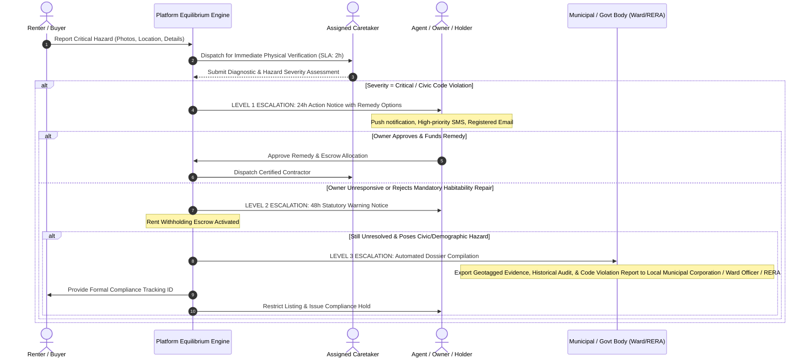
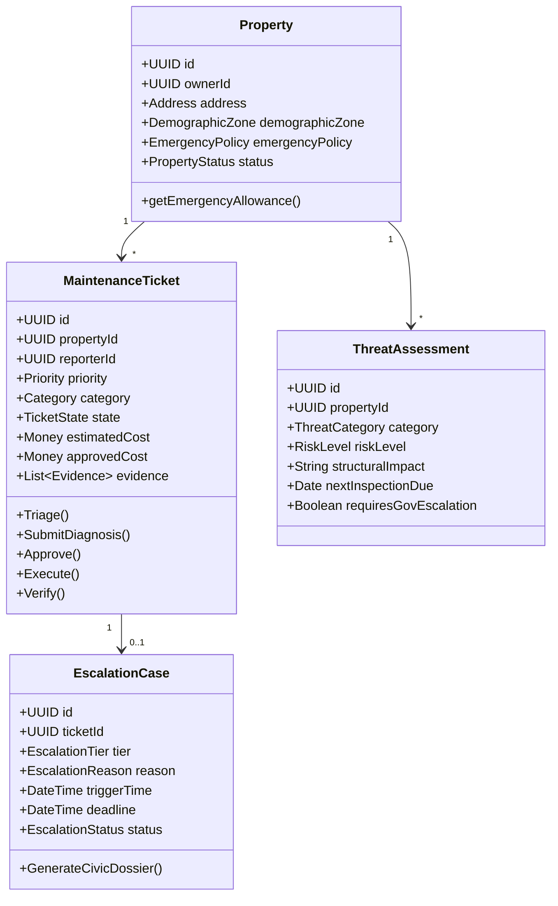

# Architecture & Specification: Maintenance & Management Equilibrium Engine

**Document:** `docs/architecture/maintenance-management-equilibrium.md`  
**Related Specifications:** `.ai/prd.md`, `.ai/architecture.md`, `AGENTS.md`  
**Core Domain:** Property Caretaking, Asset Preservation & Habitability Balance  

---

## 1. Executive Vision & Core Dilemma

In property caretaking and real estate management, a fundamental structural tension exists between two primary stakeholders:

```mermaid
flowchart LR
    subgraph Owner["Agent / Owner / Holder (Asset Side)"]
        O1[Preserve Long-term Asset Value]
        O2[Control Capital & Operational Expenses]
        O3[Prevent Hidden Structural & Environmental Threats]
        O4[Verify Genuine Caretaking & Vendor Proof]
    end

    subgraph Platform["Equilibrium Engine (The Platform)"]
        P1[Predictive Threat Intelligence]
        P2[SLA Priority Triage & Emergency Float]
        P3[Dual-Sided Milestone Telemetry]
        P4[Graduated Multi-Tier Escalation Matrix]
    end

    subgraph Resident["Renter / Buyer / Payer (Habitability Side)"]
        R1[Uninterrupted Living Standards & Utilities]
        R2[Zero Infrastructure Collapse Tolerance]
        R3[Strict SLA-backed Priority Service]
        R4[Statutory & Municipal Escalation Recourse]
    end

    Owner <--> Platform <--> Resident
```



### The Stakeholder Dichotomy

| Dimension | Agent / Owner / Asset Holder | Renter / Buyer / Payer |
| :--- | :--- | :--- |
| **Primary Incentive** | Return on capital, asset longevity, budget control, and avoidance of catastrophic repair bills. | Daily habitability, rapid restoration of essential services, safety, and hygiene. |
| **Risk Exposure** | Exploitation by caretakers/vendors, unauthorized spending, tenant wear-and-tear neglect. | Service collapse (power, plumbing, HVAC, sewage), non-responsive landlords, unsafe structures. |
| **Information Need** | Regular visual updates, predictive risk warnings, quote comparisons, verifiable completion proofs. | Transparent ETA, live technician tracking, SLA certainty, hassle-free resolution. |
| **Failure Mode** | Delayed approvals leading to magnified damage (e.g., minor drip turning into ceiling collapse). | Frustration leading to rent withholding, property abandonment, legal/civic disputes. |

---

## 2. The Equilibrium Architecture: Core Pillars

To prevent the platform from becoming a one-sided tool (which causes either tenant abandonment or landlord resistance), the system implements four synchronized mechanisms:

### Pillar 1: Predictive Threat Intelligence & Preventive Caretaking (The Owner's Shield)
Instead of waiting for tenants to report failures when systems break down, the platform institutionalizes **Proactive Caretaking**:
1. **Periodic Condition Audits**: Caretakers follow standardized, photo-verified inspection checklists (foundation, plumbing shafts, electrical distribution boards, roofing, seepage).
2. **Environmental & Demographic Threat Scoring**: Automated scoring based on regional season (e.g., monsoon drainage pre-checks, seismic alerts, coastal humidity corrosion checks).
3. **Asset Lifecycle Telemetry**: Tracking equipment operational lifespan (water heaters, pumps, inverters, HVAC compressors) so owners receive replacement warnings *before* sudden breakdown.

### Pillar 2: Dynamic Priority Triage & Emergency Circuit-Breaker (The Resident's Guarantee)
All resident requests are categorized dynamically into an objective, SLA-enforced triage model:

```text
┌──────────────────────────────────────────────────────────────────────────────────┐
│                             PRIORITY TRIAGE MATRIX                              │
├───────────┬──────────────┬───────────────┬──────────────────────┬────────────────┤
│ Priority  │ Scope        │ Response SLA  │ Resolution SLA       │ Authorization  │
├───────────┼──────────────┼───────────────┼──────────────────────┼────────────────┤
│ P1        │ Water supply,│ ≤ 15 Minutes  │ ≤ 4 Hours            │ Emergency Float│
│ Emergency │ electrical,  │               │                      │ (Auto-approval │
│           │ gas, sewage  │               │                      │ up to limit)   │
├───────────┼──────────────┼───────────────┼──────────────────────┼────────────────┤
│ P2        │ Appliance,   │ ≤ 1 Hour      │ ≤ 24 Hours           │ Owner Approval │
│ Urgent    │ AC failure,  │               │                      │ (Auto-escalate │
│           │ security lock│               │                      │ if no answer)  │
├───────────┼──────────────┼───────────────┼──────────────────────┼────────────────┤
│ P3        │ Carpentry,   │ ≤ 4 Hours     │ ≤ 72 Hours           │ Standard Owner │
│ Standard  │ minor leaks, │               │                      │ Quotation Flow │
│           │ tile repair  │               │                      │                │
├───────────┼──────────────┼───────────────┼──────────────────────┼────────────────┤
│ P4        │ Cosmetic,    │ ≤ 24 Hours    │ Scheduled            │ Owner Batched  │
│ Routine   │ painting,    │               │ Maintenance Window   │ Review         │
│           │ aesthetics   │               │                      │                │
└───────────┴──────────────┴───────────────┴──────────────────────┴────────────────┘
```

#### The Emergency Authorization Float (Pre-authorized Escrow)
- Owners configure an **Emergency Spending Limit** (e.g., ₹5,000 / $100) and an escrow reserve.
- For **P1 Emergencies**, the caretaker and verified vendor are instantly authorized to mobilize and stop the collapse immediately without waiting for an owner in another time zone.
- Anti-Fraud Safeguard: Vendor must supply real-time GPS check-in, live before-photos, and itemized receipts into the audit log.

---

## 3. Graduated Escalation & Demographic/Government Compliance

When major structural, environmental, or habitability issues arise (e.g., building cracks, unaddressed sewage backups, hazardous electrical load, zoning violations) and the owner does not or cannot act, the platform follows an objective, statutory-aligned escalation protocol:



### Escalation Tiers Defined

1. **Tier 1 (Internal SLA Breach - 12 to 24 Hours)**:
   - High-priority multi-channel alert to the Owner/Agent.
   - Platform Operations team receives an active watchdog alert.
   - Alternate contact or secondary property manager is notified.

2. **Tier 2 (Habitability & Escrow Protection - 48 Hours)**:
   - If a landlord refuses or ignores a legally mandated repair (running water, sanitary drainage, structural stability), the tenant's current rental payment is routed into a **Secure Dispute Escrow**.
   - The caretaker is granted platform-governed intervention to execute basic stabilization repairs charged against the property account.

3. **Tier 3 (Statutory / Municipal / Demographic Escalation)**:
   - Applied when conditions violate local civic/demographic codes (e.g., Municipal Corporation Building Safety Norms, Fire Safety Regulations, RERA Tenancy Guidelines, Environmental Pollution Act).
   - **Automated Civic Dossier Generator**: Generates an exportable, tamper-evident PDF dossier containing:
     - Property identity, geographical coordinates, and municipal ward identifiers.
     - Timestamped and geotagged photographs of the structural/safety violation.
     - Caretaker diagnostic report and vendor structural inspection findings.
     - Complete communication and notice timeline sent to the owner.
   - Facilitates direct filing with local municipal ward offices, fire departments, or housing regulatory authorities.

---

## 4. Domain Model & Aggregate Boundaries

In accordance with our Modular Monolith architecture, the equilibrium logic is integrated cleanly into the domain model:



### Key Aggregate Invariants
- `INV-MAINT-001`: An emergency P1 ticket may bypass manual owner quote approval if and only if estimated cost is within the pre-configured `EmergencySpendingLimit`.
- `INV-MAINT-002`: An escalation cannot advance to Tier 3 (Civic/Government) without an on-site physical verification by an authorized caretaker or licensed inspector.
- `INV-MAINT-003`: Every maintenance completion requires cryptographic/tamper-evident evidence (timestamped photos, vendor invoice, caretaker sign-off).
- `INV-MAINT-004`: Any dispute over habitability automatically locks the disputed funds into escrow until verified by physical inspection.

---

## 5. System Workflows & Lifecycle Transitions

### 5.1 Maintenance Ticket State Machine
```text
[REPORTED]
    │
    ▼
[AUTO-TRIAGED] ────────► (If Emergency & ≤ Float Limit) ──► [AUTO-APPROVED]
    │                                                            │
    ▼                                                            ▼
[CARETAKER-INSPECTED]                                      [VENDOR-DISPATCHED]
    │                                                            │
    ▼                                                            ▼
[QUOTATION-SUBMITTED]                                      [WORK-IN-PROGRESS]
    │                                                            │
    ▼                                                            ▼
[OWNER-PENDING-APPROVAL]                                   [WORK-COMPLETED]
    │                                                            │
    ├─► [APPROVED] ──► [VENDOR-DISPATCHED]                       ▼
    │                                                      [CARETAKER-VERIFIED]
    └─► [SLA BREACHED] ──► [ESCALATED (T1/T2/T3)]                │
                                                                 ▼
                                                           [OWNER-SETTLED]
```

### 5.2 Threat Detection & Caretaker Periodic Audit Workflow
1. **Scheduler Trigger**: Monthly or seasonal cron triggers an automated inspection task in the `Task and Workflow Module`.
2. **Caretaker Mobile Flow**:
   - Geofenced mobile app ensures caretaker is physically inside the property.
   - Mandatory inspection points: Main water valves, electrical meter/MCB, seepage meters, window seals, structural beams.
   - High-resolution photographic evidence captured with EXIF and SHA-256 hash.
3. **Owner Portal Digest**:
   - Visual "Property Health Index" (0-100 score).
   - "Identified Hazards & Early Warning Recommendations" (e.g., "Slight dampness detected on North wall; fixing exterior silicone caulk now for ₹1,200 avoids ₹40,000 plaster replacement later").

---

## 6. Implementation Blueprint in the Modular Monolith

This capability is mapped into our existing module structure without breaking architectural boundaries:

| Capability | Implementing Module | Interaction Pattern |
| :--- | :--- | :--- |
| **Ticket Lifecycle & Triage** | `modules/maintenance` | Core Domain Aggregates, State Machine |
| **Emergency Escrow & Spending Limit** | `modules/transaction` & `modules/property` | Synchronous In-Process Port (`ITransactionPublicApi`) |
| **Periodic Caretaker Inspection** | `modules/caretaking` & `modules/task` | Task assignment, Geofence verification |
| **Escalation Watchdog** | `modules/scheduler` | Cron monitoring SLA deadlines every 5 minutes |
| **Multi-Channel Alerts (SMS, Push, WhatsApp, Email)** | `modules/notification` | Asynchronous Domain Events (`maintenance.sla_warning`) |
| **Immutable Audit & Civic Dossier** | `modules/audit` & `modules/document` | Tamper-evident log & PDF dossier generator |

---

## 7. Strategic Impact: The Win-Win Equilibrium

By balancing management and maintenance through transparent intelligence and automated safeguards:
1. **Owners gain peace of mind**: Their capital is safeguarded by preventive checks; no surprise collapses occur; expenses are transparent; and rogue caretakers cannot commit fraud.
2. **Renters & Buyers gain trust**: They live in safe, well-maintained homes with guaranteed SLA turnaround, emergency protection, and a clear escalation channel.
3. **The Platform gains defensibility**: High user retention, reduced litigation, recurring management subscription value, and a reputation as the most reliable property ecosystem.
